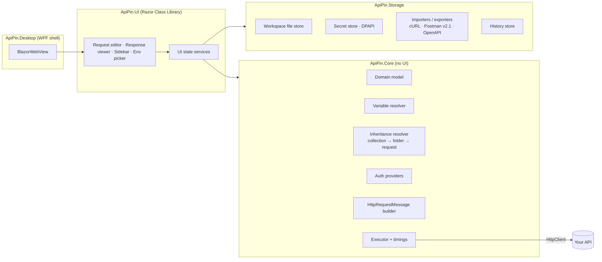

# ApiPin — Implementation Plan

> A lightweight, local-first alternative to Postman for testing the APIs I develop.
> Version 1.0 · 2026-11-05

---

## 1. Goals and scope

### 1.1 Product goals

| Priority | Capability | What "done" means |
|---|---|---|
| **Key** | Build and send HTTP requests | Any method, URL, query/path params, headers, auth, and body; readable response with status, timing, size, headers and formatted body |
| **Key** | Security / auth | None, Basic, Bearer, API Key, OAuth 2.0 (client credentials, then auth code + PKCE), Windows/Negotiate; auth inheritance from collection/folder |
| **Secondary** | Request collections | Folders and requests saved on disk, organised, reordered, duplicated, shared via Git |
| **Secondary** | Environment management | Named environments (local / dev / staging…), `{{variables}}` everywhere, secrets kept out of Git |

### 1.2 Guiding principles

1. **Lightweight** – fast start-up (< 1.5 s), small install, low idle memory; no account, no cloud sync, no telemetry.
2. **Local-first and Git-friendly** – collections and environments are plain JSON files in a folder that can live next to the app's source code.
3. **Keyboard-friendly** – `Ctrl+Enter` sends, `Ctrl+S` saves, `Ctrl+T` opens a new tab.
4. **Engine separate from UI** – all HTTP, variable and auth logic lives in a UI-free library, so it can be unit-tested and reused by a CLI runner later.

### 1.3 Explicitly out of scope (v1)

- Team workspaces, cloud sync, user accounts
- Mock servers, API monitoring, API documentation publishing
- Full JavaScript pre-request/test scripting (declarative captures and assertions cover the main need; see Phase 7)
- WebSockets, gRPC, Server-Sent Events (candidates for v2)

---

## 2. Technology decisions

### 2.1 Why a desktop app (not a pure web app)

A browser web app cannot call arbitrary APIs: **CORS** blocks requests to most servers, and browsers forbid setting some headers (`Host`, `Cookie`, `Origin`…). Requests must therefore be sent from a native process. That process must also be able to reach `localhost` APIs and accept self-signed dev certificates.

### 2.2 Recommended stack

| Layer | Choice | Reason |
|---|---|---|
| Runtime | **.NET 10 (LTS)** | Your strongest platform; `HttpClient`/`SocketsHttpHandler` gives full control over TLS, redirects, proxies and HTTP/2/3 |
| UI technology | **Blazor Hybrid** (Razor components) | UI written in C# + Razor; HTML/CSS layout skills are enough; large component ecosystem |
| Desktop host | **WPF + `BlazorWebView`** (WebView2) | Windows-native shell. WebView2 is already installed on Windows 10/11, so the binary stays small (unlike Electron, which bundles Chromium) |
| Component library | **Microsoft Fluent UI Blazor** (`Microsoft.FluentUI.AspNetCore.Components`) | Data grids, tabs, tree view, dialogs, dark/light theme out of the box |
| Code editor | **Monaco** via `BlazorMonaco` | VS Code editor: JSON/XML syntax highlighting, folding, formatting, search, large-file handling |
| MVVM / state | Plain C# state services + `INotifyPropertyChanged` (or `CommunityToolkit.Mvvm`) | Simple, testable, no JS state library |
| Serialization | `System.Text.Json` with polymorphic `[JsonDerivedType]` | Built in, fast, AOT-friendly |
| Secrets | **Windows DPAPI** (`ProtectedData`, CurrentUser scope) | Secret values encrypted at rest and never written to the workspace folder |
| Tests | xUnit + FluentAssertions (or Shouldly) + bUnit (components) | Standard .NET tooling |
| Packaging | Self-contained single-file publish + **Velopack** (installer + auto-update) | One-click install and updates without the Microsoft Store |
| CI | GitHub Actions (build, test, publish artifact on tag) | Free for this use |

**Portability path:** all UI components live in a Razor Class Library. If you later want macOS/Linux, add a **Photino.Blazor** or **.NET MAUI** host project. No UI rewrite is needed; only the shell project changes.

### 2.3 Alternative considered

| Option | Pros | Cons | Verdict |
|---|---|---|---|
| Avalonia UI (XAML, native) | Truly native, cross-platform, very light | XAML learning curve; fewer ready-made components (no Monaco-grade editor; AvaloniaEdit is good but more work) | Solid plan B |
| Tauri / Electron + React | Mainstream for this kind of tool | Requires a modern frontend stack; Electron is heavy (the problem we're solving) | Rejected |
| Local web server + browser (Blazor Server on `localhost`) | Cross-platform, no installer | Feels less like an app; port and lifetime management | Possible later as a secondary host |

---

## 3. Architecture



### 3.1 Request execution pipeline

```
RequestDefinition (as saved)
  │ 1. Inheritance  – merge collection/folder headers, auth, variables
  │ 2. Variables    – resolve {{var}} and {{$dynamic}} with scope precedence
  │ 3. Auth         – provider adds headers/query (fetches/caches OAuth tokens)
  │ 4. Build        – URL + query encoding, headers, body content
  │ 5. Send         – HttpClient from a handler pool keyed by settings
  │ 6. Capture      – status, headers, cookies, body bytes, size, timings
  ▼
ResponseResult  →  UI · History · (Phase 7) captures & assertions
```

### 3.2 Solution layout

```
ApiPin/
├─ ApiPin.slnx
├─ Directory.Build.props          # nullable, warnings-as-errors, LangVersion, common metadata
├─ Directory.Packages.props       # central package versions
├─ src/
│  ├─ ApiPin.Core/                # models, resolver, auth, builder, executor
│  ├─ ApiPin.Storage/             # file workspace, secrets, history, import/export
│  ├─ ApiPin.UI/                  # Razor Class Library: components, layouts, state services
│  ├─ ApiPin.Desktop/             # WPF host, DI composition root, window chrome
│  └─ ApiPin.Cli/                 # (Phase 7) `apipin run` collection runner
├─ tests/
│  ├─ ApiPin.Core.Tests/
│  ├─ ApiPin.Storage.Tests/
│  ├─ ApiPin.UI.Tests/            # bUnit
│  └─ ApiPin.IntegrationTests/    # real HTTP against EchoServer
├─ tools/
│  └─ ApiPin.EchoServer/          # minimal API used for manual and automated testing
├─ docs/
└─ .github/workflows/ci.yml
```

### 3.3 Domain model (sketch)

```csharp
public sealed class RequestDefinition
{
    public Guid Id { get; init; }
    public string Name { get; set; } = "New request";
    public string Method { get; set; } = "GET";            // free text allows custom verbs
    public string Url { get; set; } = "";                  // may contain {{vars}} and :pathParams
    public List<KeyValueItem> QueryParams { get; } = [];
    public List<KeyValueItem> PathParams { get; } = [];
    public List<KeyValueItem> Headers { get; } = [];
    public AuthConfig Auth { get; set; } = new InheritAuth();
    public BodyConfig Body { get; set; } = new NoBody();
    public RequestSettings Settings { get; set; } = new();
    public int Seq { get; set; }                           // ordering inside folder
    // Phase 7
    public List<CaptureRule> Captures { get; } = [];
    public List<Assertion> Assertions { get; } = [];
}

public sealed record KeyValueItem(string Key, string Value, bool Enabled = true, string? Description = null);

[JsonPolymorphic(TypeDiscriminatorPropertyName = "type")]
[JsonDerivedType(typeof(NoAuth), "none")]
[JsonDerivedType(typeof(InheritAuth), "inherit")]
[JsonDerivedType(typeof(BasicAuth), "basic")]
[JsonDerivedType(typeof(BearerAuth), "bearer")]
[JsonDerivedType(typeof(ApiKeyAuth), "apikey")]
[JsonDerivedType(typeof(OAuth2Auth), "oauth2")]
[JsonDerivedType(typeof(WindowsAuth), "windows")]
public abstract record AuthConfig;

[JsonPolymorphic(TypeDiscriminatorPropertyName = "type")]
[JsonDerivedType(typeof(NoBody), "none")]
[JsonDerivedType(typeof(RawBody), "raw")]                 // json | xml | text | html | javascript
[JsonDerivedType(typeof(FormUrlEncodedBody), "form")]
[JsonDerivedType(typeof(MultipartBody), "multipart")]     // text + file parts
[JsonDerivedType(typeof(BinaryFileBody), "binary")]
[JsonDerivedType(typeof(GraphQlBody), "graphql")]         // Phase 6
public abstract record BodyConfig;

public sealed record RequestSettings(
    int TimeoutMs = 30_000,
    bool FollowRedirects = true,
    int MaxRedirects = 10,
    bool VerifyTls = true,                // off for local dev certs
    string? HttpVersion = null,           // null = auto, "1.1", "2", "3"
    string? ClientCertificateRef = null); // Phase 6: mTLS

public sealed record ResponseResult(
    int StatusCode, string? ReasonPhrase, Version HttpVersion,
    IReadOnlyList<KeyValuePair<string, string>> Headers,
    byte[] Body, string? ContentType, long SizeBytes,
    TimingInfo Timings, IReadOnlyList<Cookie> Cookies,
    Exception? Error);                    // network/TLS/timeout errors shown nicely
```

### 3.4 Variables

- **Syntax:** `{{name}}`; dynamic: `{{$guid}}`, `{{$timestamp}}`, `{{$isoTimestamp}}`, `{{$randomInt}}`, `{{$randomEmail}}`.
- **Scopes (highest wins):** runtime/captured → active environment → collection → global.
- **Where resolved:** URL, query, path params, headers, auth fields, body (raw/form/multipart text parts).
- **Secrets:** a variable flagged `secret` is masked in the UI. Its value lives in the DPAPI-encrypted store, not in the env file.
- **UX:** resolved value shown on hover; unresolved variables underlined red; preview of the fully-resolved request before sending.
- **Nesting:** values may reference other variables (`{{baseUrl}}/{{version}}`), with cycle detection and a depth limit.

### 3.5 On-disk workspace format

A workspace is a folder you can commit to Git (e.g. inside the API's repo under `/api-tests`):

```
my-api-tests/
├─ apipin.workspace.json          # name, version, default env, globals (non-secret)
├─ .gitignore                     # generated: ignores .apipin/
├─ environments/
│  ├─ local.env.json              # { "name": "Local", "variables": [{ "key": "baseUrl", "value": "https://localhost:5001" }, { "key": "apiKey", "secret": true }] }
│  └─ staging.env.json
├─ collections/
│  └─ orders-api/
│     ├─ collection.json          # name, auth, headers, variables, seq
│     ├─ auth/
│     │  ├─ folder.json
│     │  └─ login.req.json
│     └─ orders/
│        ├─ folder.json
│        ├─ get-order.req.json
│        └─ create-order.req.json
└─ .apipin/                       # local only: UI state, open tabs (never committed)
```

App-level data (not in the workspace) goes in `%APPDATA%\ApiPin\`: `settings.json` (theme, recent workspaces, window layout), `secrets.dat` (DPAPI, keyed by workspace ID + env + variable), `history.db` (SQLite, or rolling JSON files).

Rules: one request per file; file names are slugified request names; `seq` controls order; files are written atomically (temp file + rename); stable property order and 2-space indentation keep Git diffs clean; a file watcher reloads external changes (e.g. after `git pull`).

### 3.6 HttpClient handling

- One `SocketsHttpHandler` per distinct `(VerifyTls, FollowRedirects, MaxRedirects, Proxy, ClientCert, HttpVersion)` combination, pooled and reused. This avoids socket exhaustion while honouring per-request settings.
- **Cookies:** `UseCookies = false` on the handler. ApiPin manages its own cookie jar per environment, so cookies are visible and editable.
- **Timings:** total time, time-to-first-byte (`HttpCompletionOption.ResponseHeadersRead`), and connect/TLS phases via `ConnectCallback` + `SslStream` measurement. Download time is measured separately.
- **Cancellation:** a Cancel button linked to a `CancellationToken`, plus the per-request timeout.
- **Large bodies:** responses are streamed to a buffer with a cap (e.g. show the first 10 MB, offer "Save full response to file").
- **Decompression:** automatic gzip/deflate/brotli, with the raw `Content-Encoding` still shown.

---

## 4. Delivery phases

Effort is in **focused dev-days** for one developer. Each phase ends with a usable, demo-able build.

### Phase 0 — Foundation (≈ 2–3 days)

- [x] Create the solution, projects and `Directory.Build.props` / `Directory.Packages.props` (nullable on, warnings as errors)
- [x] WPF host with `BlazorWebView` rendering a "Hello ApiPin" Razor component; Fluent UI theme wired (dark/light follows Windows) (plain CSS light/dark theme instead of Fluent UI)
- [x] DI composition root in `ApiPin.Desktop`; `ILogger` to a rolling file in `%APPDATA%\ApiPin\logs` (one file per day, 14 days kept; unhandled exceptions are logged)
- [x] **EchoServer** minimal API: `/echo` (returns method, headers, query, body), `/status/{code}`, `/delay/{ms}`, `/redirect/{n}`, `/auth/basic`, `/auth/bearer`, `/auth/apikey`, `/cookies/set`, `/upload`, `/large/{mb}`, `/oauth/token` (fake client-credentials server) (also password, refresh-token and auth-code + PKCE grants via `/oauth/authorize`, and `/oauth/me` as a protected resource; HTTPS on 7090 uses the ASP.NET dev certificate when present)
- [x] GitHub Actions: restore → build → test on push/PR
- [x] `README.md` with build/run instructions

**Exit criteria:** `dotnet build` is green, the app window opens, and EchoServer runs on `https://localhost:7090`.

### Phase 1 — Core engine (≈ 5–6 days)

- [x] Domain model (§3.3) with JSON round-trip tests
- [x] URL parser that keeps `{{vars}}` and `:pathParams` intact; two-way sync between the URL and the query-params list
- [x] `VariableResolver`: scopes, dynamic vars, nesting, cycle detection, list of unresolved names (scopes: runtime → environment → folders → collection → globals; dynamic vars also include `$randomUUID` and `$randomAlphaNumeric`)
- [x] `HttpRequestBuilder`: method, URL encoding, headers (including restricted ones such as `Host`), all body types with correct `Content-Type` and multipart boundaries
- [x] Auth providers: None, Basic, Bearer, API Key (header or query)
- [x] `HttpExecutor`: handler pool, timeout, cancellation, decompression, timings, size, error mapping (DNS failure, connection refused, TLS error, timeout → friendly messages)
- [x] Integration tests against EchoServer, covering every body type and auth type (`tests/ApiPin.IntegrationTests` starts the real EchoServer in-process, with HTTPS on a throwaway self-signed certificate; Windows auth is not covered because the EchoServer has no Negotiate endpoint)

**Exit criteria:** a unit/integration test can build any request from a `RequestDefinition` and get a correct `ResponseResult`. Core coverage ≥ 80%.

### Phase 2 — MVP UI: request editor and response viewer (≈ 7–8 days)

**Milestone: "replaces Postman for ad-hoc calls".**

- [x] App layout: left sidebar (empty for now), main area with request tabs, resizable split between request and response (vertical/horizontal toggle)
- [x] Request bar: method dropdown (with colour coding), URL box, **Send** / **Cancel** button; `Ctrl+Enter` sends
- [x] Sub-tabs: **Params** (query + path), **Headers**, **Auth**, **Body**, **Settings**
- [x] Reusable `KeyValueGrid` component: enable checkbox, key, value, description, bulk-edit text mode, auto-append empty row, common-header autocomplete
- [x] Auth tab: type selector and forms for None / Inherit / Basic / Bearer / API Key (Inherit came with the `InheritanceResolver` in Phase 3; new requests inherit by default)
- [x] Body tab: none / raw (JSON, XML, text) in Monaco with **Format** button / form-urlencoded / multipart with file picker / binary file (plain text editor instead of Monaco)
- [x] Response panel: status pill (colour by class), time, size; tabs **Body** (Pretty via Monaco read-only, Raw, Preview for HTML and images), **Headers**, **Cookies**, **Timings** (Pretty uses a built-in syntax highlighter instead of Monaco)
- [x] Response actions: copy body, save to file, search in body
- [x] Settings tab: timeout, follow redirects, verify TLS (warning badge when off)
- [x] Unsaved "scratch" tabs persisted across restarts in `.apipin/` or app data

**Exit criteria:** you can call your own local API with JSON bodies and bearer tokens entirely through the UI, using self-signed dev certs.

### Phase 3 — Workspaces and collections (≈ 7–8 days)

- [x] Open/create a workspace folder; reopen the last one on start; recent workspaces in the sidebar's `⋯` menu
- [x] `WorkspaceStore`: load/save collections, folders and requests per §3.5; atomic writes; stable JSON formatting
- [x] Sidebar tree: collections → folders → requests with method badges; filter/search box
- [x] CRUD: new collection/folder/request, rename (dialog), duplicate, delete (with confirmation)
- [x] **Drag-and-drop** reorder and move (requests, folders and collections; files and folders move on disk)
- [x] Save (`Ctrl+S`), dirty indicator on tabs, "Save as…" into a collection; prompt on closing unsaved tabs
- [x] Export a collection as Postman Collection v2.1 (import stays in Phase 6) (collection/folder auth and collection variables carry over; folder headers are added to each request since Postman has none)
- [x] Collection- and folder-level settings: headers, auth, variables, description (markdown) (a settings dialog from the item's `⋯` menu; the description is stored as Markdown but edited as plain text)
- [x] `InheritanceResolver`: auth `inherit` walks up to folder → collection; headers merge (request wins on conflict) (the request editor shows where inherited auth and headers come from; `RequestPreparer` runs inheritance, then variables, before sending)
- [x] `FileSystemWatcher` reloads changed files and flags conflicts with open dirty tabs (unedited tabs pick up the new version; edited ones offer "use the version on disk" or "keep my changes")
- [x] Storage tests: round-trip, rename/move on disk, corrupted-file handling (skip and report, never crash)

**Exit criteria:** a collection created in ApiPin can be committed to Git, cloned on another machine and opened unchanged.

### Phase 4 — Environments and variables (≈ 5 days)

- [x] Environment files per §3.5; **environment picker** in the top bar; "No environment" option (the picked environment is kept per workspace in `.apipin/state.json`, which a generated `.gitignore` keeps out of Git)
- [x] Environment editor: grid with key, value, secret toggle, enabled; duplicate environment; globals editor (globals live in `apipin.workspace.json`)
- [x] `SecretStore` using DPAPI; secret values never written to workspace files; "missing secret" indicator after cloning (also for secret collection/folder variables and globals; keyed by a workspace id so copies don't mix)
- [x] Variable highlighting in the URL, headers and body editors: resolved = green with hover tooltip, unresolved = red (also params and form fields; dynamic variables are blue)
- [x] `{{` autocomplete listing the variables available in the current scope
- [x] "Resolved request preview" panel (final URL, headers, body after substitution; secrets masked) (the request editor's **Resolved** tab, with undefined variables listed)
- [x] Quick-look eye icon: shows all variables in effect and where each one comes from (env / collection / global) (overridden values are listed too)

**Exit criteria:** switching `Local` ↔ `Staging` re-targets every request in a collection without edits, and no secret appears in `git diff`.

### Phase 5 — Advanced auth and connection options (≈ 5–6 days)

- [x] **OAuth 2.0 client credentials**: token URL, client ID/secret, scope, audience, credentials in body vs Basic header. Tokens cached until expiry and refreshed automatically; "Get new token" and "Clear token" buttons; token viewer that decodes JWT claims (`TokenService` in Core; token requests use the request's TLS and certificate settings)
- [x] **OAuth 2.0 authorization code + PKCE**: system browser + loopback redirect listener (`http://127.0.0.1:{port}/callback`); refresh-token support (default redirect `http://localhost:7890/callback`; the listener is a plain socket, so no URL ACL or admin rights; state is checked)
- [x] **OAuth 2.0 password grant** (legacy, for older apps)
- [x] **Windows / Negotiate (NTLM/Kerberos)** using current credentials or explicit ones
- [x] **Azure helper (optional):** "Use Azure CLI token" – runs `az account get-access-token --resource {{resource}}`, which is handy for APIs secured by Entra ID (an auth type of its own; `--scope` is used for values ending in `/.default`; optional tenant)
- [x] Client certificates (mTLS): PFX file + password (secret) or a Windows certificate store thumbprint (per request, in the Settings tab; the EchoServer's `/certs/client` shows what it received)
- [x] Proxy settings: system proxy / custom / none, with bypass list (app-wide, in the new ⚙ Settings dialog; wildcard bypass entries and optional proxy credentials)
- [x] HTTP version selection (1.1 / 2 / 3)

**Exit criteria:** you can call an Entra-ID-protected API and a mutual-TLS endpoint without copying tokens by hand. (Verified against the EchoServer's OAuth server and mTLS endpoint and a faked Azure CLI; not yet against a real Entra ID tenant.)

### Phase 6 — Productivity (≈ 6–7 days)

- [x] **History**: every sent request + response summary (body optional, size-capped); searchable; "restore into new tab"; retention settings (rolling `history.jsonl` in app data; sidebar History view; retention in ⚙ Settings)
- [x] **cURL import** (paste a `curl` command → a request) and **Copy as cURL** (paste into the URL bar or the Import dialog; bash and Windows cmd forms, as browsers copy them)
- [x] **Code snippets**: C# `HttpClient`, PowerShell `Invoke-RestMethod`, JavaScript `fetch`, Python `requests` (plus cURL for bash and cmd; variables resolved or left as written)
- [x] **Postman collection v2.1 import**, including environments (migration path from Postman) (v2.0 too; scripts and unsupported auth types are listed as warnings)
- [x] **OpenAPI 3 import** → collection, one request per operation, with example bodies (`Microsoft.OpenApi` library) (JSON or YAML, Swagger 2.0 too; folders per tag, `{{baseUrl}}` from the first server, bodies from examples or generated from schemas, collection auth from the security scheme)
- [x] Cookie jar viewer/editor per environment (cookies are stored from responses and sent automatically unless turned off per request; jars last until the app closes)
- [x] GraphQL body type: query + variables editors
- [x] Keyboard shortcut map and command palette (`Ctrl+K`) (commands, every saved request and environments; `Ctrl+/` for the map, `Ctrl+E` environments, `Ctrl+Shift+C` code)
- [x] Tab management: reorder, close others, reopen closed tab (`Ctrl+Shift+T`) (drag tabs; right-click for close others / to the right / all, duplicate)

**Exit criteria:** an existing Postman collection imports cleanly and the common daily flows are possible from the keyboard.

### Phase 7 — Chaining, assertions and CLI (≈ 6–7 days)

- [x] **Captures** (no scripting): after a response, set a variable from JSONPath / header / regex / status. Example: `login` → `$.accessToken` → `{{token}}`. Target scope: runtime or active environment (engine, runner and CLI done; single sends in the app apply them too, but there is no editor for them in the UI yet — edit the `captures` list in the request file)
- [x] **Assertions** (declarative): status equals/in range, header exists/equals, JSONPath equals/contains/exists, response time < N ms, body matches a JSON Schema (also body contains/matches, < and >; JSONPath and JSON Schema are built-in subsets; same note as captures: no UI editor yet)
- [ ] Test results tab on the response panel (pass/fail list)
- [ ] **Collection runner** in the UI: run a folder/collection in order with an environment, optional iteration count and delay; summary report
- [x] **`ApiPin.Cli`** as a `dotnet tool`: `apipin run ./my-api-tests --collection orders-api --env staging --reporter junit` (reuses Core + Storage), so the same collections run in CI pipelines (GitHub Actions / Azure DevOps) (console, JUnit and JSON reporters; `--folder`, `--var`, `APIPIN_VAR_*`, `--iterations`, `--delay`, `--bail`, `--insecure`, `--timeout`; exit codes 0 / 1 / 2)

**Exit criteria:** the login → create → get → delete flow runs green both in the UI runner and in CI via the CLI. (CLI half met: `samples/echo-api-tests` runs green against the EchoServer, including its new token-protected `/items` API. Still to do: the captures/assertions editor in the request editor, the test results tab and the UI runner.)

### Phase 8 — Packaging and release (≈ 3 days)

- [ ] Self-contained single-file publish for `win-x64` (and `win-arm64`); trimmed where safe
- [ ] Velopack installer + auto-update from GitHub Releases
- [ ] App icon, About dialog, version info, crash log with "Open logs folder"
- [ ] Release workflow: on tag `v*` → build, test, package, publish the GitHub Release (done for a zipped self-contained `win-x64` build; installer packaging comes with Velopack)
- [ ] Performance check: cold start < 1.5 s, idle RAM < 200 MB, a 10 MB JSON response renders without freezing

**Exit criteria:** a one-click installer on a clean Windows machine, with updates delivered automatically.

### Summary timeline

| Phase | Focus | Effort (dev-days) | Cumulative |
|---|---|---|---|
| 0 | Foundation | 2–3 | 3 |
| 1 | Core engine | 5–6 | 9 |
| 2 | **MVP UI** ← first useful release | 7–8 | 17 |
| 3 | Collections | 7–8 | 25 |
| 4 | Environments | 5 | 30 |
| 5 | Advanced auth | 5–6 | 36 |
| 6 | Productivity | 6–7 | 43 |
| 7 | Chaining + CLI | 6–7 | 50 |
| 8 | Packaging | 3 | 53 |

**Key + secondary features (Phases 0–5) take ≈ 36 dev-days.** Phases 6–8 are enhancements and can be reordered by need. Packaging (Phase 8) can be pulled forward to right after Phase 4 if you want an installed build early.

---

## 5. UI layout (target)

```
┌──────────────────────────────────────────────────────────────────────────┐
│ ApiPin   [Workspace: my-api-tests ▾]            [Env: Local ▾] [👁] [⚙]   │
├───────────────┬──────────────────────────────────────────────────────────┤
│ 🔍 filter      │ [GET get-order ●] [POST login] [+]                       │
│ ▾ orders-api   │ ┌──────┬──────────────────────────────────────┬────────┐ │
│   ▾ auth       │ │ GET ▾│ {{baseUrl}}/orders/:id?expand=items  │  Send  │ │
│     POST login │ └──────┴──────────────────────────────────────┴────────┘ │
│   ▾ orders     │ Params | Headers (3) | Auth | Body | Settings | Tests     │
│     GET get…   │ ┌──────────────────────────────────────────────────────┐ │
│     POST crea… │ │ ☑ expand   items                                     │ │
│ ▸ users-api    │ │ ☐ key      value                                     │ │
│               │ └──────────────────────────────────────────────────────┘ │
│ ─────────────  ├──────────────────────────────────────────────────────────┤
│ History        │ 200 OK · 142 ms · 2.3 KB                                 │
│               │ Body | Headers (9) | Cookies | Timings | Tests (3/3)     │
│               │ { "id": 42, "status": "Shipped", ... }  [Pretty|Raw]    │
└───────────────┴──────────────────────────────────────────────────────────┘
```

---

## 6. Testing strategy

| Level | Tooling | Focus |
|---|---|---|
| Unit | xUnit | Variable resolver, URL parser, inheritance, auth header generation, cURL parser, importers |
| Integration | xUnit + EchoServer (started in-process via `WebApplicationFactory` or on a random Kestrel port) | Real HTTP: bodies, redirects, TLS off, timeouts, cancellation, cookies, OAuth token flow |
| Storage | xUnit with temp directories | Round-trip, atomic writes, rename/move, corrupted files, secrets never written to the workspace |
| Component | bUnit | `KeyValueGrid`, URL ↔ params sync, auth forms, dirty-state tracking |
| Manual smoke | Checklist in `docs/smoke-test.md` | Run before each release against EchoServer and one real app of yours |

**Dogfooding:** from Phase 2 onward, use ApiPin instead of Postman for your own APIs and log friction points as issues.

---

## 7. Risks and mitigations

| Risk | Impact | Mitigation |
|---|---|---|
| URL ↔ query-param sync breaks with `{{vars}}` or unusual encodings | Annoying editing bugs | A dedicated tolerant tokenizer (no `Uri` parsing until send time); heavy unit tests with edge cases |
| Monaco in WebView2 feels slow for very large bodies | UI freezes | Cap the displayed size; virtualised raw view; "save to file" for big responses |
| Blazor ↔ JS interop complexity (Monaco, drag-and-drop) | Slower UI development | Use proven packages (`BlazorMonaco`, Fluent UI tree/grid); keep JS in one small isolated module |
| OAuth flows differ between providers | Token acquisition failures | Start with client credentials (simplest); test against Entra ID plus a fake server in EchoServer; show the raw token response for debugging |
| Secrets leak into Git | Security incident | Secrets only in DPAPI store; generated `.gitignore`; a test asserting that no secret value appears in workspace files |
| Windows-only shell | No macOS/Linux | UI kept in a Razor Class Library; the Photino/MAUI host is an isolated later task |
| Scope creep toward "full Postman" | Never ships | Phase gates; anything not listed goes to a `v2-ideas.md` backlog |

---

## 8. Definition of Done (per feature)

- Code merged with CI green; nullable warnings clean
- Unit/integration tests for the engine logic; bUnit test for non-trivial components
- Works in both dark and light themes
- Keyboard accessible (tab order, shortcut where it makes sense)
- No secret values in logs or workspace files
- `CHANGELOG.md` updated

---

## 9. Immediate next steps

1. Install the .NET 10 SDK and Visual Studio 2026 / Rider; check that the WebView2 runtime is present.
2. Run Phase 0: scaffold the solution layout (§3.2) and EchoServer.
3. `git init`, push to GitHub, enable the CI workflow.
4. Start Phase 1 with the `VariableResolver` and URL parser, test-first, because the rest of the engine depends on them.

## 10. Backlog / v2 ideas

WebSockets and SSE clients · gRPC (reflection-based) · JavaScript/C# script hooks · response diff between two runs · macOS/Linux host (Photino) · load-test mode (N parallel requests, latency percentiles) · mock responses from saved examples · AI helper ("generate a request from this OpenAPI operation / explain this error response").
